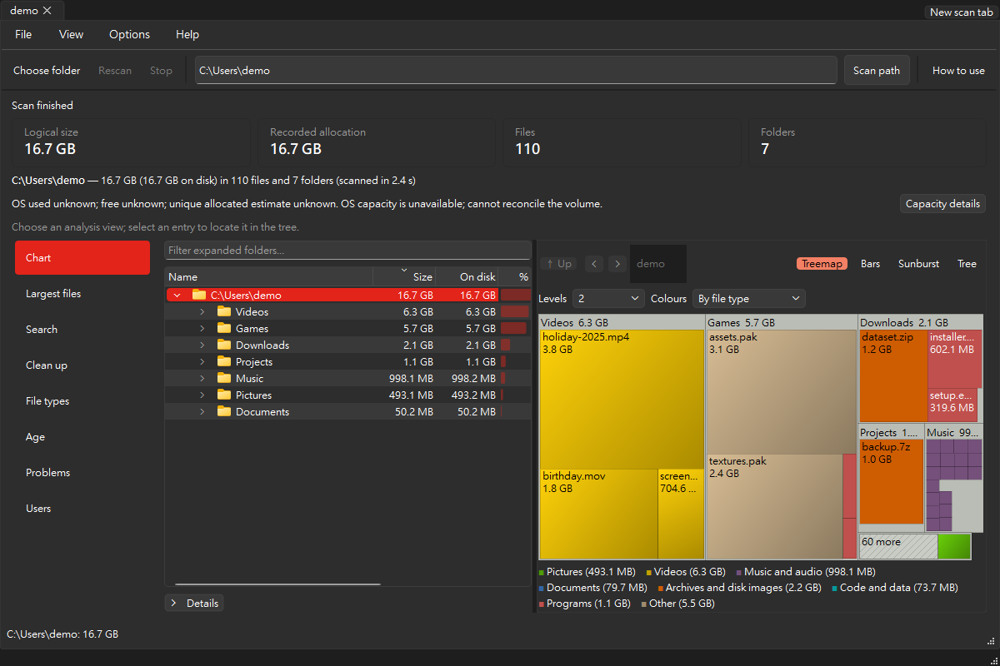

# FileTree

**Find out what's filling up your disk.**

FileTree scans a folder or drive and shows which files and folders take the most space.
Use the folder tree, colourful chart and largest-file list to decide what to keep or clean up.

[English](README.md) | [繁體中文](README/README_zh-TW.md) | [简体中文](README/README_zh-CN.md) | [日本語](README/README_ja.md) | [한국어](README/README_ko.md)



## What you can do

- **Find large files and folders**: see the biggest items first, including after cleaning or rescanning a folder. Charts show their share of the space. Browsing and filtering reuse sorted rows and sort unopened subfolders only when needed.
- **Search and filter**: find files by name, type, size or last change. Sorting, units and tree filters keep visible selections. Tree filters reuse unchanged results, map each opened group once, and skip hidden archive members. Tree filters keep large selections and their gaps while retaining less cached data. Large result lists sort with one value calculation per row.
- **Review clean-up suggestions**: inspect caches, temporary files and duplicates before acting. Large lists display and select efficiently; large batches of skipped or failed entries remain available in complete, copyable tables. Keeper choices and space estimates keep your selection and view position.
- **See what grew**: compare scans to find folders using more space than before.
- **Save reports**: export results to CSV, JSON or Excel.
- **Use your language**: switch between English, Traditional Chinese, Simplified Chinese, Japanese and Korean.
- **Explorer folder menu (Windows)**: add Scan with FileTree from Options. Settings stay responsive; an active Save finishes before closing.

## Install

### Windows: no Python needed

1. Download `FileTree-<version>-windows-standalone.zip` from [Releases](https://github.com/JeffreyChen-s-Utils/FileTree/releases).
2. Extract the **whole ZIP**.
3. Run `FileTree.exe` inside the extracted folder. Keep the other files beside it.

An MSI installer is also available for installation through Windows.

### Windows, macOS or Linux: with Python

Requires **Python 3.10 or newer**:

```bash
python -m pip install je_file_tree
je-file-tree
```

On Windows, you can use `py -3` instead of `python`.
For running from source or building a standalone app, see the [detailed guide](docs/guide.md) and [build guide](nuitka.md).

## Get started

1. **Choose a folder or drive**, or drag a folder into the window.
2. **Wait for the scan**, then browse the largest folders and files. Bigger chart blocks mean more space used.
3. **Review anything you want to remove**, then right-click → **Move to Recycle Bin**. FileTree asks for confirmation, displaying filenames and paths as written.

You can stop a scan at any time; the results collected so far stay visible and are marked incomplete.
Starting a new scan cancels pending folder-list calculations and discards their old results.

## Things to know

- Moving files to the Recycle Bin or Trash **does not free disk space until you empty it**.
- Clean-up suggestions need your review. Background monitoring is off by default and does not clean up automatically.
- Folders that cannot be read appear under **Problems**; their contents are missing from the totals.
- Scans do not follow symbolic links or junctions. File size and space used on disk can differ.
- Windows may ask for administrator rights at startup. You can decline and scan accessible folders. A restart requested from the window waits in the background; complete or dismiss the Windows prompt to finish. Restart reopens scan tabs in order and rescans their folder lists with each tab’s current scan choices.
- Advanced actions such as emptying Trash or linking duplicate copies have separate confirmations and consequences; read the [detailed guide](docs/guide.md) first.

## Keyboard shortcuts

| Key | Action |
|---|---|
| Ctrl+O | Choose a folder |
| F5 | Rescan |
| Esc | Stop the scan |
| Ctrl+F | Search |
| Delete | Move selected items to the Recycle Bin |
| F1 | Open help |
| Ctrl+Q | Quit |

On macOS, use ⌘ instead of Ctrl; use ⌘R to rescan.

## Learn more

- [Detailed usage and technical notes](docs/guide.md): all features, command-line examples, settings and limitations.
- [Build guide](nuitka.md): create a standalone app with Nuitka.
- [Core API](docs/core-api.md) and [architecture](architecture.md): integrate with or develop FileTree.
- [Update log](docs/updates/README.md): changes and validation records.

## License

[MIT](LICENSE).
