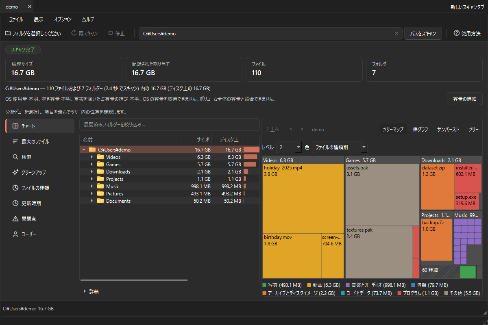

# FileTree

**ディスクの容量を何が使っているのか、すぐに確認。**

FileTree はフォルダーやドライブをスキャンし、容量の大きいファイルやフォルダーを表示します。
フォルダーツリー、色付きの図、大きいファイルの一覧を見ながら、残すものや整理するものを選べます。

[English](../README.md) | [繁體中文](README_zh-TW.md) | [简体中文](README_zh-CN.md) | [日本語](README_ja.md) | [한국어](README_ko.md)



予算一覧では矢印キーで行を選び、Tab で編集欄へ移動します。検索を開き直すと名前欄が見える位置までスクロールします。

## できること

- 「フォルダー容量予算」で正確な上限を設定できます。使用量と超過量は選択した単位で表示し、観測日時とスキャン待ち・不明の状態を分けて示します。
- 管理画面を開いた時点のタブを名前付きワークスペースとして保存できます。読み込みプレビューを編集し、置換の影響を確認して読み込みます。開始を押すまでスキャンしません。
- 結果の要点から、直下の大きいフォルダー、整理候補、スキャン制限の各画面を開けます。
- ホームまたは「オプション」からスキャン設定を保存し、パスと設定を再利用できます。設定画面を開いても、ほかのタブのスキャンは続行します。
- 整理後の件数を保持し、操作履歴、利用可能な元に戻す操作、元のフォルダーの再スキャンを開けます。
- **大きいファイルやフォルダーを探す**：大きい順に確認し、整理やフォルダーの再スキャン後も更新したサイズで並べます。図で容量の割合も把握できます。閲覧や絞り込みは並べ替え済みの行を再利用し、未展開の子フォルダーは必要なときに並べ替えます。
- **検索・絞り込み**：名前、種類、サイズ、更新日時でファイルを探せます。並べ替え、単位変更、ツリーの絞り込みでも表示中の選択を保持します。ツリーの絞り込みは同じ結果を再利用し、開いたグループごとに一度だけ行を対応付け、非表示の圧縮ファイル内の項目を逐一照合しません。ツリーの絞り込みでは、大量の選択と未選択の間隔を保ち、キャッシュに残すデータを減らします。大量の結果一覧でも、各行の並べ替え値は一度だけ計算します。 範囲指定では正確なサイズと開始日・終了日を含むローカル日付を指定でき、保存した検索にも保持されます。
- **整理候補を確認する**：キャッシュ、一時ファイル、重複ファイルを調べてから操作できます。大きな一覧で単位や言語を変えても選択を保ち、多数のスキップ項目や移動失敗は、省略のない表で確認・コピーできます。重複ファイルの保持ファイルを選んだときや容量見積もりが完了したときも、選択と表示位置を保持します。グループの結果をまとめて展開し、一覧のすべてのファイルを保持します。
- **増えたフォルダーを見つける**：以前のスキャンと比較し、容量が増えた場所を確認できます。
- **フォルダーの推移を見る**：スキャン履歴で読み込み済みフォルダーと最近の期間または指定日付を選択。グラフの点や行を選ぶとサイズ、符号付きの変化、不明の理由を確認できます。
- **レポートを保存する**：結果を CSV、JSON、Excel に出力できます。 大量の一覧コピーでは行とテキストを分割して準備し、別の一覧を含む新しいコピーが未完了の要求を置き換えます。
- **言語を切り替える**：英語、繁体字中国語、簡体字中国語、日本語、韓国語に対応しています。
- **エクスプローラーのフォルダーメニュー（Windows）**：「オプション」から「FileTree でスキャン」を追加できます。設定中も画面は応答し、開始済みの保存が完了してから閉じます。

適用中の検索条件を結果の上に表示します。条件は個別またはまとめて解除でき、日付はカレンダーから選べます。

## インストール

### Windows：Python は不要

1. [Releases](https://github.com/JeffreyChen-s-Utils/FileTree/releases) から `FileTree-<version>-windows-standalone.zip` をダウンロードします。
2. ZIP を**すべて展開**します。
3. 展開したフォルダーの `FileTree.exe` を実行します。他のファイルも同じ場所に残してください。

Windows でインストールできる MSI インストーラーも用意されています。

### Windows・macOS・Linux：Python を使う

**Python 3.10 以降**が必要です。

```bash
python -m pip install je_file_tree
je-file-tree
```

Windows では `python` の代わりに `py -3` を使えます。
ソースからの実行や単独で動くアプリの作成は、[詳細ガイド](../docs/guide_ja.md)と[ビルドガイド](../nuitka.ja.md)を参照してください。

## 使い始める

1. **フォルダーやドライブを選ぶ**。フォルダーをウィンドウにドラッグしても開始できます。
2. **スキャンが終わったら確認する**。大きいフォルダーやファイルから見ていきます。図の四角が大きいほど、多くの容量を使っています。
3. **不要な項目を確認する**。右クリック → **ごみ箱に移動**を選びます。実行前の確認画面では、ファイル名とパスがそのまま表示されます。

スキャンはいつでも停止できます。読み取り済みの結果は残り、不完全な結果として表示されます。
予期しないスキャンエラーは失敗として報告され、ワーカーが失敗した結果を完了とは表示しません。
ワーカーの起動に失敗した場合、起動済みスレッドの終了を待ってからエラーを表示します。
新しいスキャンを始めると、処理中のフォルダー一覧の集計をキャンセルし、古い結果を破棄します。

## 知っておきたいこと

- ごみ箱に移しただけでは空き容量は増えません。**ごみ箱を空にすると容量が解放されます**。
- 整理候補は自分で確認してください。バックグラウンド監視は初期設定では無効で、自動整理も行いません。
- 読み取れないフォルダーは**問題点**に表示され、その中身は合計サイズに含まれません。
- スキャンはシンボリックリンクやジャンクションをたどりません。ファイルサイズとディスク使用量は異なることがあります。
- Windows では起動時に管理者権限を求めることがあります。拒否しても、読み取り権限のあるフォルダーをスキャンできます。ウィンドウからの再起動要求はバックグラウンドで待機するため、Windows の確認を完了するか閉じてください。再起動後はスキャンタブを順番どおりに開き直し、各タブの現在のスキャン設定でフォルダー一覧を再スキャンします。
- ごみ箱を空にする操作や重複ファイルのハードリンク化には、それぞれ確認と注意点があります。先に[詳細ガイド](../docs/guide_ja.md)をお読みください。

## よく使うショートカット

| キー | 操作 |
|---|---|
| Ctrl+O | フォルダーを選ぶ |
| F5 | 再スキャン |
| Esc | スキャンを停止 |
| Ctrl+F | 検索 |
| Delete | 選択項目をごみ箱へ移動 |
| F1 | ヘルプを開く |
| Ctrl+Q | 終了 |

macOS では Ctrl の代わりに ⌘ を使います。再スキャンは ⌘R です。

## 詳しく知る

- [詳しい使い方と技術情報](../docs/guide_ja.md)：全機能、コマンドラインの例、設定、制限。
- [ビルドガイド](../nuitka.ja.md)：Nuitka で単独で動くアプリを作成。
- [コア API](../docs/core-api.md)と[構成](../architecture.md)：FileTree の連携・開発。
- [更新履歴](../docs/updates/README.md)：変更内容と検証記録。

## セキュリティ

脆弱性は非公開で報告してください。方針、サポート対象のバージョン、運用上の注意は [SECURITY.md](../SECURITY.md) にあります。

## ライセンス

[MIT](../LICENSE)。
