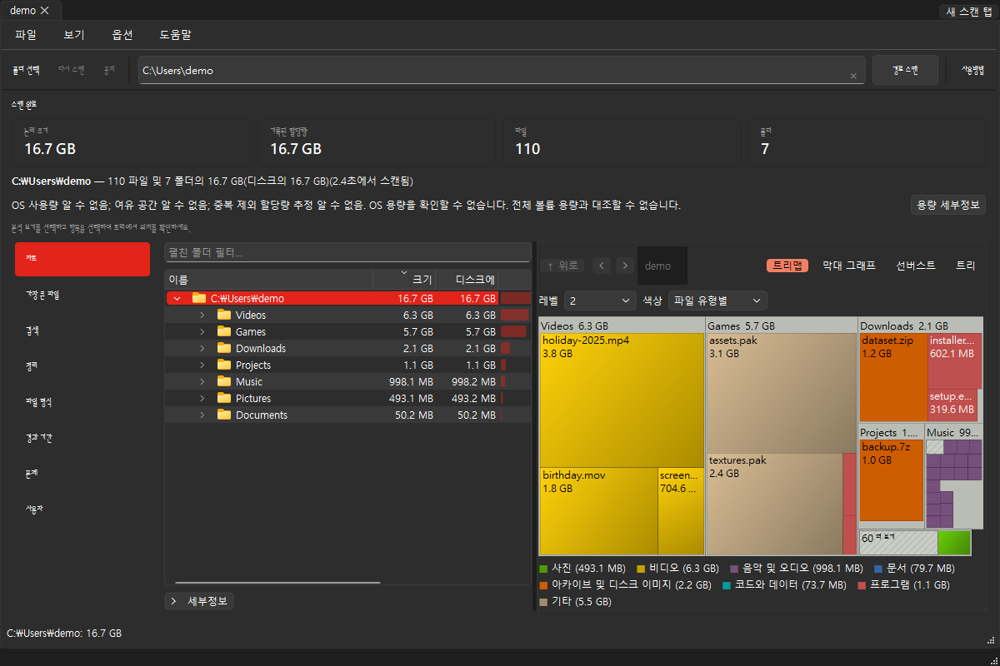

# FileTree

**디스크 공간을 무엇이 차지하는지 빠르게 확인하세요.**

FileTree는 폴더나 드라이브를 스캔하고 공간을 많이 차지하는 파일과 폴더를 보여줍니다.
폴더 트리, 색상 차트, 큰 파일 목록을 보면서 보관할 항목과 정리할 항목을 고를 수 있습니다.

[English](../README.md) | [繁體中文](README_zh-TW.md) | [简体中文](README_zh-CN.md) | [日本語](README_ja.md) | [한국어](README_ko.md)



## 할 수 있는 일

- **큰 파일과 폴더 찾기**: 큰 항목부터 확인하며 정리하거나 폴더를 다시 스캔한 뒤에도 갱신된 크기로 정렬합니다. 차트로 공간 비율도 파악합니다. 탐색과 필터링은 정렬된 행을 재사용하며 펼치지 않은 하위 폴더는 필요할 때 정렬합니다.
- **검색과 필터**: 이름, 종류, 크기, 수정 시간으로 파일을 찾습니다. 정렬, 단위 변경이나 트리 필터링 때 계속 표시되는 항목의 선택을 유지합니다. 트리 필터는 같은 결과를 재사용하고 펼친 그룹마다 행을 한 번 매핑하며 숨겨진 압축 파일 항목은 일일이 확인하지 않습니다. 트리 필터는 많은 선택 항목과 선택하지 않은 간격을 유지하면서 대기 시간을 줄입니다. 많은 결과를 정렬할 때 각 행의 정렬 값은 한 번만 계산합니다.
- **정리 제안 검토**: 캐시, 임시 파일, 중복 파일을 살펴보고 처리 여부를 결정합니다. 큰 목록도 빠르게 표시하고 선택하며 건너뛰거나 이동에 실패한 많은 항목은 전체 표에서 확인하고 복사할 수 있습니다.
- **커진 폴더 찾기**: 이전 스캔과 비교해 공간이 늘어난 곳을 확인합니다.
- **보고서 저장**: 결과를 CSV, JSON, Excel로 내보냅니다.
- **언어 변경**: 영어, 중국어 번체, 중국어 간체, 일본어, 한국어를 지원합니다.
- **탐색기 폴더 메뉴(Windows)**: 옵션에서 FileTree로 스캔을 추가하세요. 설정 중에도 창이 응답하며 이미 시작한 저장을 마친 후 닫힙니다.

## 설치

### Windows: Python 없이 실행

1. [Releases](https://github.com/JeffreyChen-s-Utils/FileTree/releases)에서 `FileTree-<version>-windows-standalone.zip`을 다운로드합니다.
2. ZIP을 **전체 압축 해제**합니다.
3. 압축을 푼 폴더의 `FileTree.exe`를 실행합니다. 나머지 파일도 같은 폴더에 두세요.

Windows에서 설치할 수 있는 MSI 설치 프로그램도 제공합니다.

### Windows, macOS, Linux: Python 사용

**Python 3.10 이상**이 필요합니다.

```bash
python -m pip install je_file_tree
je-file-tree
```

Windows에서는 `python` 대신 `py -3`를 사용할 수 있습니다.
소스에서 실행하거나 독립 실행 앱을 빌드하려면 [자세한 안내](../docs/guide_ko.md)와 [빌드 안내](../nuitka.ko.md)를 참고하세요.

## 시작하기

1. **폴더나 드라이브를 선택합니다.** 폴더를 창으로 끌어다 놓아도 됩니다.
2. **스캔이 끝나면 결과를 확인합니다.** 큰 폴더와 파일부터 살펴보세요. 차트의 사각형이 클수록 차지하는 공간이 큽니다.
3. **필요 없는 항목을 확인합니다.** 마우스 오른쪽 버튼 → **휴지통으로 이동**을 선택합니다. 실행 전 확인 창에는 파일 이름과 경로의 문자를 그대로 표시합니다.

스캔은 언제든 중지할 수 있습니다. 읽은 결과는 유지되며 불완전한 결과로 표시됩니다.
새 스캔을 시작하면 진행 중인 폴더 목록 집계를 취소하고 이전 결과를 버립니다.

## 알아둘 점

- 휴지통으로 옮기는 것만으로는 여유 공간이 늘지 않습니다. **휴지통을 비워야 공간이 확보됩니다.**
- 정리 제안은 직접 검토해야 합니다. 백그라운드 모니터링은 기본적으로 꺼져 있으며 자동 정리는 하지 않습니다.
- 읽을 수 없는 폴더는 **문제**에 표시되며, 그 안의 내용은 전체 크기에 포함되지 않습니다.
- 스캔은 심볼릭 링크나 정션을 따라가지 않습니다. 파일 크기와 실제 디스크 사용량은 다를 수 있습니다.
- Windows 시작 시 관리자 권한을 요청할 수 있습니다. 거절해도 읽기 권한이 있는 폴더는 스캔할 수 있습니다. 창에서 요청한 재시작은 백그라운드에서 대기하므로 Windows 요청을 완료하거나 닫으세요.
- 휴지통 비우기나 중복 파일의 하드 링크 전환은 별도의 확인 절차와 영향을 갖습니다. 먼저 [자세한 안내](../docs/guide_ko.md)를 읽어보세요.

## 자주 쓰는 단축키

| 키 | 기능 |
|---|---|
| Ctrl+O | 폴더 선택 |
| F5 | 다시 스캔 |
| Esc | 스캔 중지 |
| Ctrl+F | 검색 |
| Delete | 선택한 항목을 휴지통으로 이동 |
| F1 | 도움말 열기 |
| Ctrl+Q | 종료 |

macOS에서는 Ctrl 대신 ⌘를 사용합니다. 다시 스캔은 ⌘R입니다.

## 더 알아보기

- [자세한 사용법과 기술 정보](../docs/guide_ko.md): 전체 기능, 명령줄 예제, 설정, 제한 사항.
- [빌드 안내](../nuitka.ko.md): Nuitka로 독립 실행 앱 만들기.
- [코어 API](../docs/core-api.md)와 [구조](../architecture.md): FileTree 연동 및 개발.
- [업데이트 기록](../docs/updates/README.md): 변경 사항과 검증 기록.

## 라이선스

[MIT](../LICENSE).
