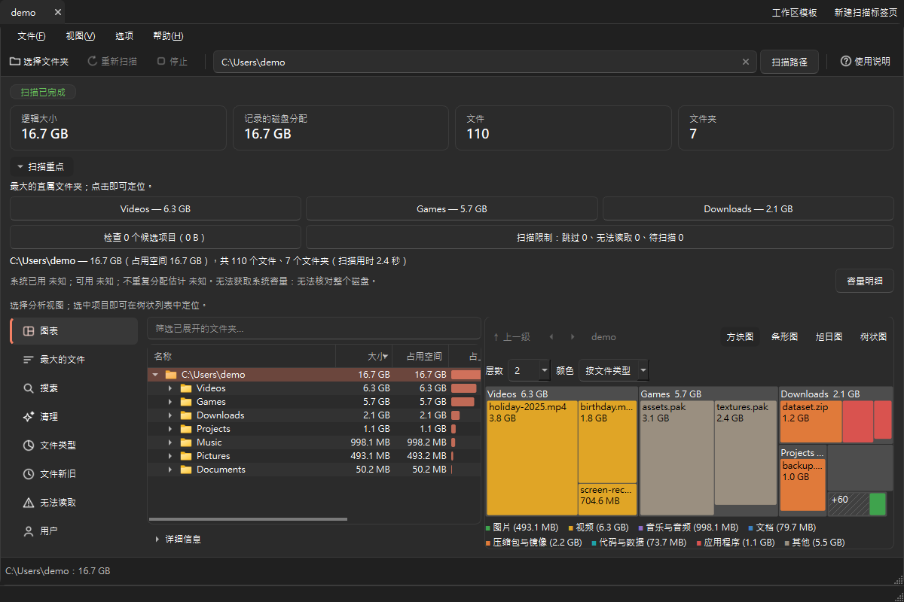

# FileTree

**快速找出磁盘空间都被什么占用了。**

FileTree 会扫描文件夹或磁盘，列出最占空间的文件与文件夹。
通过文件夹树、彩色矩形图和最大文件列表，帮你决定哪些要保留、哪些可以清理。

[English](../README.md) | [繁體中文](README_zh-TW.md) | [简体中文](README_zh-CN.md) | [日本語](README_ja.md) | [한국어](README_ko.md)



## 可以做什么

- 在“文件夹容量预算”设置精确上限。用量和超出量使用所选大小单位，并单独显示观测时间、等待扫描和未知状态。
- 将多个标签页保存为命名工作区模板，预览并检查路径后，明确替换标签页。加载后点击开始才会扫描。
- 结果重点会链接最大的直属文件夹、清理候选项目与扫描限制，方便直接查看。
- 从首页或“选项”保存常用扫描设置，重复加载路径与扫描选项。打开编辑器不会中断其他标签页的扫描。
- 清理后保留结果数字，并提供操作记录、可用的撤销与明确重新扫描原文件夹的入口。
- **找出大文件、大文件夹**：从最大的项目开始看，清理或重新扫描文件夹后也会按更新的大小排序，并用图表了解空间占比。浏览与筛选会复用已排序的数据行，尚未展开的子文件夹则按需排序。
- **搜索与筛选**：按名称、类型、大小或修改时间查找文件。排序、切换单位或文件夹树筛选时会保留仍可见的选中项目；树形筛选会复用相同结果，为每个已打开的组建立一次映射，并跳过隐藏的压缩包成员。切换树形筛选时，会保留大量选择及未选中的间隔，并减少缓存数据。大量结果列表排序时，每行只计算一次排序值。自定义范围支持精确大小与包含起止日的本地日期，保存的搜索会保留这些范围。
- **查看清理建议**：检查缓存、临时文件和重复文件，再决定是否处理。大型列表切换单位或语言时会保留选择；大量已跳过或移动失败的项目，可在完整表格中查看和复制。选择重复文件的保留副本与空间估算完成时，都会保留选择和查看位置。分组结果会一并展开，保留所有列出的文件。
- **找出变大的文件夹**：比较前后两次扫描，看看空间增加在哪里。
- **跟踪文件夹趋势**：选中文件夹并打开扫描历史，应用日期范围查看大小变化及直属来源。
- **导出报告**：将结果保存为 CSV、JSON 或 Excel。 大量列表复制会分批准备数据行与文本；任何列表的新复制都会替换尚未完成的请求。
- **切换语言**：支持英语、繁体中文、简体中文、日语和韩语。
- **资源管理器文件夹菜单（Windows）**：从“选项”添加“使用 FileTree 扫描”。设置操作时窗口仍可响应；已开始的保存完成后才会关闭。

搜索结果上方显示已应用条件，可逐项清除或全部清除，日期也可从日历选择。

## 安装

### Windows：无需安装 Python

1. 到 [Releases](https://github.com/JeffreyChen-s-Utils/FileTree/releases) 下载 `FileTree-<version>-windows-standalone.zip`。
2. **完整解压** ZIP 文件。
3. 运行文件夹内的 `FileTree.exe`，其他文件请一起保留。

也提供 MSI 安装程序，可通过 Windows 安装。

### Windows、macOS、Linux：使用 Python

需要 **Python 3.10 或更新版本**：

```bash
python -m pip install je_file_tree
je-file-tree
```

Windows 可以用 `py -3` 代替 `python`。
从源码运行或编译成独立程序，请看[完整说明](../docs/guide_zh-CN.md)和[编译指南](../nuitka.zh-CN.md)。

## 开始使用

1. **选择文件夹或磁盘**，也可以直接把文件夹拖进窗口。
2. **等待扫描完成**，查看最大的文件夹和文件。图上的矩形越大，表示占用空间越多。
3. **确认不需要的项目**，右键 → **移到回收站**。程序会先询问确认，并按原样显示文件名与路径。

扫描过程中可以随时停止；已读取的结果会保留，并标记为不完整。
扫描发生意外错误时会报告失败；工作线程失败后不会将结果标记为完成。
工作线程启动失败时，会先等待已启动的工作线程结束，再显示错误。
开始新的扫描会取消尚未完成的文件夹列表统计，并丢弃旧结果。

## 使用前了解这些就好

- 文件移到回收站后，**要清空回收站才会释放空间**。
- 清理建议需要自行检查。后台监视默认关闭，也不会自动清理。
- 没有读取权限的文件夹会列在**无法读取**标签页中，里面的内容不会计入总大小。
- 扫描不会跟随符号链接或目录联接。文件大小与实际占用磁盘空间可能不同。
- Windows 启动时可能询问管理员权限；拒绝后仍可扫描有权限读取的文件夹。从窗口请求重新启动时，会在后台等待；请完成或关闭 Windows 提示。重新启动会按顺序重开扫描标签页，保留各标签页当前的扫描选项，重新扫描各自的文件夹列表。
- 清空回收站、将重复文件改成硬链接等高级操作，有各自的确认步骤与影响；使用前请看[完整说明](../docs/guide_zh-CN.md)。

## 常用快捷键

| 按键 | 功能 |
|---|---|
| Ctrl+O | 选择文件夹 |
| F5 | 重新扫描 |
| Esc | 停止扫描 |
| Ctrl+F | 搜索 |
| Delete | 将选中项目移到回收站 |
| F1 | 打开帮助 |
| Ctrl+Q | 退出程序 |

macOS 请用 ⌘ 代替 Ctrl，重新扫描则用 ⌘R。

## 更多说明

- [完整使用说明与技术细节](../docs/guide_zh-CN.md)：所有功能、命令行示例、设置与限制。
- [编译指南](../nuitka.zh-CN.md)：用 Nuitka 创建独立程序。
- [核心 API](../docs/core-api.md)和[项目架构](../architecture.md)：集成或开发 FileTree。
- [更新记录](../docs/updates/README.md)：功能变更与验证记录。

## 安全

请私下报告漏洞。政策、支持版本与操作者注意事项见 [SECURITY.md](../SECURITY.md)。

## 许可证

[MIT](../LICENSE)。
